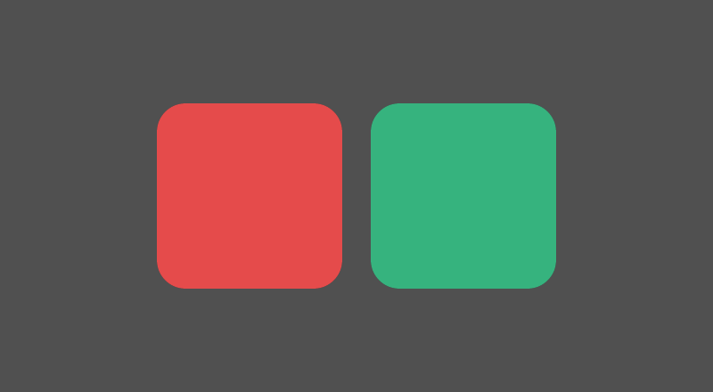

# Draw SVGs with an egui Painter

This example uses **egui / egui_extras 0.37.0** to load an SVG as a texture and draw it with `Painter::image`. The drawing helper takes a `&Painter`, a URI and a destination rectangle. It does not create an image widget.



## Run

Use Rust **1.95 or newer**:

```sh
cargo test --locked
cargo run --locked --features window
```

The window shows the red and green shapes from [assets/tiles.svg](assets/tiles.svg). Resizing the window changes their destination rectangle. The optional window host uses eframe's required `App::ui` callback; its SVG drawing goes through a saved `Context` and a layer `Painter`.

## Use the same path in your application

Enable the SVG loader:

```toml
egui = "=0.37.0"
egui_extras = { version = "=0.37.0", default-features = false, features = ["svg"] }
```

Install loaders once for your context and register the bytes:

```rust
egui_extras::install_image_loaders(ctx);
ctx.include_bytes("bytes://tiles.svg", include_bytes!("../assets/tiles.svg").as_slice());
```

Keep the `.svg` suffix: the SVG loader uses the URI's extension to select the format. These bytes are embedded; this example needs no filesystem or HTTP loader.

During an egui pass, use your existing `Painter` and call [paint_svg](src/lib.rs):

```rust
let rect = egui::Rect::from_min_size(egui::pos2(24.0, 32.0), egui::vec2(120.0, 60.0));
match painter_svg::paint_svg(&painter, "bytes://tiles.svg", rect) {
    Ok(Some(_texture_id)) => {},
    Ok(None) => {}, // Pending load or an empty destination; pending requests repaint.
    Err(error) => eprintln!("SVG could not be drawn: {error}"),
}
```

The helper calls `Context::try_load_texture` with `SizeHint::Width`, using the rectangle's logical width multiplied by the painter's pixels per point. Once ready, it passes that texture ID, the rectangle, full-image UVs and a white tint to `Painter::image`. The loaders cache the result, so this path can run again each frame.

SVGs are rasterized at the requested resolution. The loader preserves their aspect ratio; match the destination rectangle to that ratio to avoid stretching the texture. Text within SVGs needs the separate `svg_text` feature and suitable fonts; this sample uses shapes only. Other raster formats need their corresponding loader features.

## Verification

The headless tests inspect actual rasterized RGBA pixels, transparency, texture uploads, Painter mesh geometry and tessellated output. They also check a second frame, resizing, 2× pixel density, missing loader configuration, a missing URI extension and malformed SVG errors. They explicitly count the drawing callback so an omitted pass cannot look successful.

The window was also run on macOS 14.6 / Apple silicon with Rust 1.98.1, and its actual Glow framebuffer was captured and inspected. This was software-operated validation. Other platforms, renderers, SVG text, external assets and the original requester's application have not been verified.

- [Public image-loader setup](https://docs.rs/egui_extras/0.37.0/egui_extras/fn.install_image_loaders.html)
- [Context texture loading](https://docs.rs/egui/0.37.0/egui/struct.Context.html#method.try_load_texture)
- [Painter image drawing](https://docs.rs/egui/0.37.0/egui/struct.Painter.html#method.image)
- [Related usage question](https://github.com/emilk/egui/discussions/8451)

## Optional coffee

This example is free. If it saves you time, buying me a coffee is entirely optional.

- **USDC / SOL · Solana:** `9tY6D9mwcFaJwwzEHvw2v7nhSpdjqjNBYtuooyBN6rYy`
- **USDC / ETH · Base:** `0x568Ab98578d682FB0B0b45619BE73EbFfbf5a6eA`
- **USDT · BNB Smart Chain (BEP20):** `0x568Ab98578d682FB0B0b45619BE73EbFfbf5a6eA`
